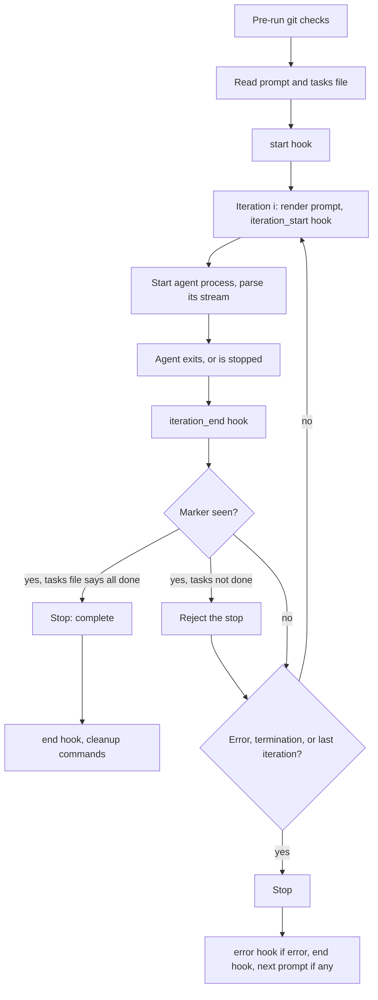

# How ralpher works

## One run, many iterations



A **run** is one invocation of `ralpher.sh`. It runs up to `--iterations`
**iterations**. Each iteration starts one agent process:

```text
<agent> <args...> [--settings {...}] [--worktree <name>] <rendered prompt>
```

with `--agent` (default `claude`) and `--args` split as a shell would. The
prompt is the last argument, so it never passes through a shell. stdin is
`/dev/null`; the agent runs in its own process group, in `--cwd` if given.

Nothing carries over between iterations except what the agent wrote to disk.
That is the point: each iteration starts with an empty context, and the
prompt tells the agent where to look (a tasks file, `git log`, a TODO list).

## Reading the stream

ralpher expects Claude Code's `--output-format stream-json` with
`--include-partial-messages`: one JSON object per line. Each line is written
raw to the stdout log, then classified:

| Line | What ralpher does |
|------|-------------------|
| text deltas | printed as they stream (`content_delta` style) |
| tool calls | the tool name and its main input, such as the command or file path (`tool_use` style) |
| a `<task>` block in text or a tool result | a task progress line, and an `llm_task_progress` hook |
| a text line equal to a stop marker | marks the iteration complete |
| a `result` with `is_error: true` | marks the iteration as an error and stops the agent |
| system messages | most are skipped; the rest print their subtype |
| an unknown line type | logged to the errors file and listed at the end of the iteration |

At the end of each iteration ralpher prints the tools used, and any unknown
tools or message types, and records them in the state file.

## Ending the loop

After each iteration, the loop stops if any of these holds:

- **complete**: a line of the agent's output was exactly a stop marker
  (`--stops`, default `<promise>COMPLETE</promise>`), and, with a tasks file,
  the [verified stop](guide/tasks.md#verified-stop) agrees;
- **error**: the agent reported an error result, exited non-zero without
  writing any stdout, or an I/O failure on the agent's output reader threads
  was logged as an error;
- **exception**: an exception in the iteration itself ends the loop at once,
  with exit reason `exception during iteration <i>` and exit status 1;
- **termination**: you pressed Ctrl+C twice, ralpher got `SIGTERM`, the agent
  asked for an operator, or ralpher detected a loop on a blocked task. See
  [Stopping a run](guide/stopping.md).

Otherwise it runs the next iteration, up to `--iterations`. Running out of
iterations is not an error: the exit reason is `completed all iterations` and
the exit status is 0. See [Exit statuses](reference/exit-statuses.md).

The marker must be a whole line on its own, after stripping whitespace. A
marker quoted inside a sentence, or inside the prompt the agent echoes, does
not count.

## The agent's environment

The agent starts with the environment ralpher was started with, minus
ralpher's own Python: `bin/activate.sh` puts ralpher's `.venv/bin` on `PATH`
and its `src` on `PYTHONPATH`, and ralpher removes both, and `VIRTUAL_ENV`
when it names that `.venv`, before starting the agent. So `python` and
`pytest` in the agent's shell are whatever the project's own setup provides
(its `bin/activate.sh`, a `direnv` `.envrc`, or your `PATH`), never
ralpher's packages. Any other virtual environment active when ralpher started
is kept.

## Settings and options

Command-line options say what to run. Settings, read from JSON files, say how
it looks and what to run around it (hooks, theme). Settings are layered:
built-in defaults, then `~/.ralpher/settings.json`, then
`.ralpher/settings.json` in the `--cwd` directory (only when `--cwd` is
given), then `--settings-file`. See
[Settings](reference/settings.md).
